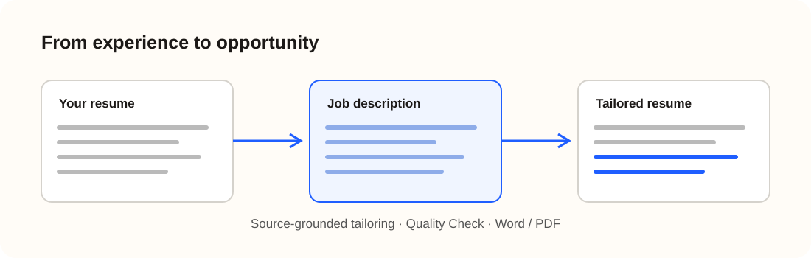

# TailorIQ

### Your experience, better positioned.

**An AI-powered resume-tailoring platform built to make job applications more relevant without inventing experience.**

[**Try TailorIQ**](https://tailoriq-production.up.railway.app/workspace) · [**Engineering case study**](docs/PROJECT_CASE_STUDY.md) · [**Architecture**](docs/ARCHITECTURE.md)

**Next.js · TypeScript · Anthropic Claude API · Tailwind CSS · GitHub · Railway**

---

## The problem I wanted to solve

During my own job search, I kept running into the same problem: **my experience had not changed, but every job posting wanted to see something different.** Tailoring the same resume again and again took time away from actually applying.

I built **TailorIQ** to simplify that repetitive process. Its goal is not keyword stuffing or manufacturing qualifications. It is to help candidates present *what they have actually done* in a way that is relevant to a specific opening.

## What it does

1. **Upload** a DOCX or text-based PDF resume.
2. **Paste** the job description and optionally select a length: 1 Page, 2 Pages, or Auto.
3. **Tailor** in one click with Anthropic Claude, using source-linked suggestions for the summary and existing experience.
4. **Review** the resume preview and Quality Check; Match Analysis offers optional supporting context.
5. **Download** a professional Word or PDF resume.

The uploaded resume is the factual source. TailorIQ is designed to keep roles, employers, education, dates, and accomplishments accurate instead of inventing qualifications.

## A look at the product

*Visual explanation of the workflow—not a screenshot of the live application.*

[**Launch the real workspace →**](https://tailoriq-production.up.railway.app/workspace)

Production screenshots can be added separately using fictional demo data; see [screenshot guidance](assets/screenshots/README.md).

## Technology stack

| Area | Technologies |
| --- | --- |
| Full-stack application | Next.js 16, React 19, TypeScript |
| Interface | Tailwind CSS 4 |
| AI integration | Anthropic Claude API and Zod |
| Resume extraction | Mammoth for DOCX, unpdf for PDF |
| Document output | docx (Word), pdf-lib (PDF) |
| Reliability | Source-fidelity checks, automated regressions, export validation |
| Development | Cursor, GitHub |
| Deployment | Railway |

## The engineering work behind it

**Parsing real documents.** Resumes contain tables, sidebars, unconventional headings, promotions, clients, concurrent contracts, career breaks, and wrapped PDF lines. Recovering the *relationship* between an employer, role, date, and duty is as important as preserving its words.

**Grounding AI in facts.** The AI proposes source-linked rewrites, while application safeguards aim to prevent fabricated titles, metrics, credentials, and responsibilities.

**Delivering usable files.** TailorIQ produces native DOCX and PDF documents, applies quality/completeness checks, and supports contact hyperlinks.

**Iterating with evidence.** Fictional resume scenarios, real AI requests, regression tests, and visual export inspections informed development.

[**Read the engineering case study →**](docs/PROJECT_CASE_STUDY.md) · [**Explore the architecture →**](docs/ARCHITECTURE.md)

## Product decisions

- One-click tailoring rather than line-by-line approval.
- Education directly beneath Professional Summary.
- Resume Length is the main user preference.
- Quality Check supports safe exports; Match Analysis is secondary.
- No automatic inline keyword bolding in finished documents.

## Scope and transparency

TailorIQ is a **controlled-beta project**. It supports DOCX and text-based PDFs, not OCR for scanned/image-only documents. Applicants should review AI-generated documents before submitting them. Match Analysis is informational, not a guarantee of qualification or hiring.

**This is a public portfolio showcase, not the production source-code repository.** No private application code, real applicant documents, credentials, or internal testing evidence is published here.

---

[**Visit TailorIQ**](https://tailoriq-production.up.railway.app) · [**Case study**](docs/PROJECT_CASE_STUDY.md) · [**Architecture**](docs/ARCHITECTURE.md)

Independent software project · 2026

