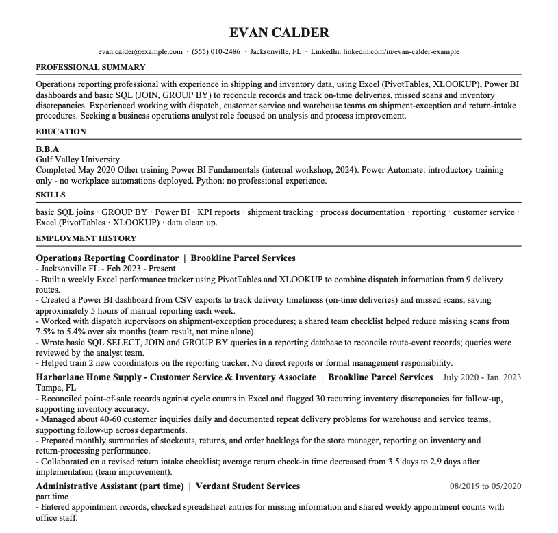
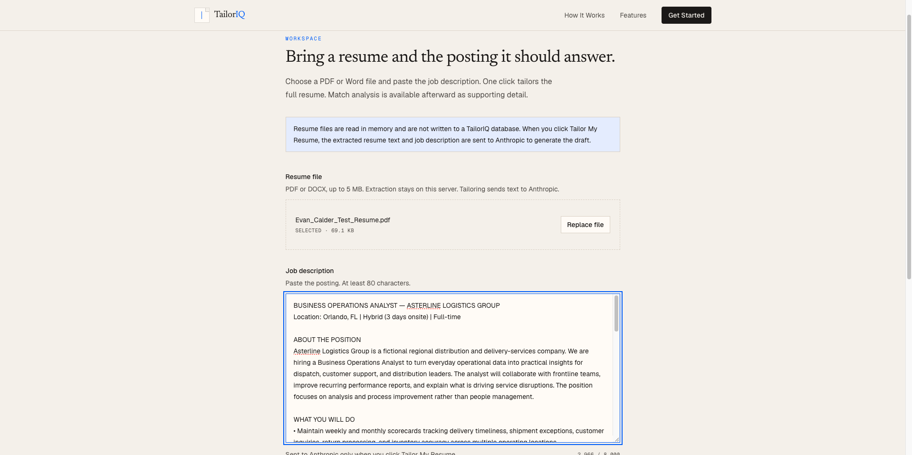
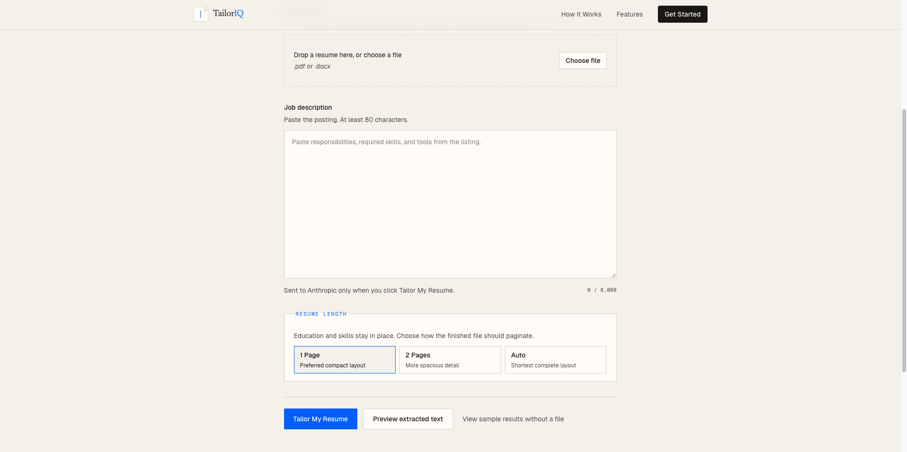
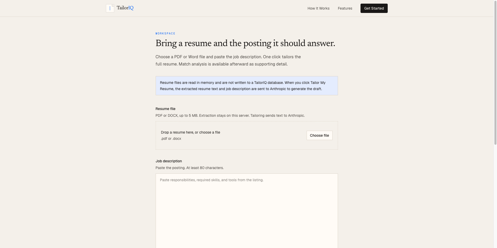
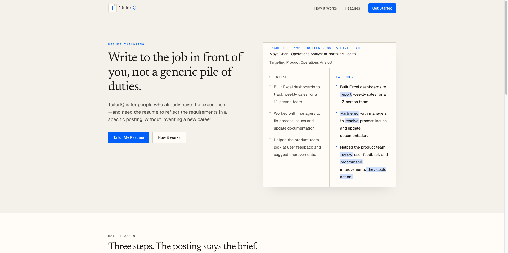

# TailorIQ screenshot gallery

These screenshots document the application with **entirely fictional** candidate and job-description content.

## Before and after

| Slightly inconsistent original resume | Tailored resume output |
| --- | --- |
|  |  |

## Tailoring workflow

## Landing page

*These are screenshots of the product during development and demonstration; interface appearance may change. All sample applicant and employer details shown are fictional.*

[Back to TailorIQ overview](../../README.md)
