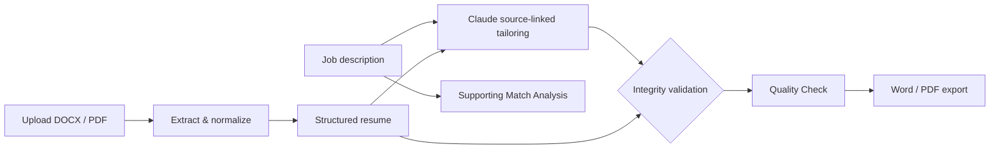

# TailorIQ — Architecture

This is a **high-level portfolio explanation**, not the private production source.

## Processing flow

## Components

| Component | Responsibility | Technology |
| --- | --- | --- |
| Workspace | Upload, description, one-click workflow | Next.js, React, TypeScript |
| Extraction | Read DOCX and text-based PDF | Mammoth, unpdf |
| Structure | Associate employers, clients, titles, dates, education and bullets | TypeScript parsing |
| AI tailoring | Source-linked summary and responsibility rewrites | Anthropic Claude, Zod |
| Factual safeguards | Validate source relationships and final document | Custom validation and regression coverage |
| Exports | Create native Word and PDF with hyperlinks | docx, pdf-lib |
| Hosting | Deploy server-side application | Railway |

## Engineering principles

**Source authority:** a job posting explains relevance, not proof that a candidate performed the job's duties.

**Relationships matter:** preserving an employer's name somewhere is insufficient if the duties are attached to the wrong job.

**Validation before export:** block materially incomplete or misassociated resumes rather than approving a misleading document.

**Primary outcome:** an accurate, professional downloadable resume. Match Analysis remains a secondary aid.

**Privacy:** server-side API keys; no public applicant records in this showcase. Uploaded material goes through the server and AI vendor for tailoring; consult the [live privacy policy](https://tailoriq-production.up.railway.app/privacy).

## Boundaries

Supports DOCX and text-based PDF; image-only PDFs are not supported by an OCR flow. The product is in controlled beta and does not promise interviews or hiring outcomes.

[Project overview](../README.md) · [Engineering case study](PROJECT_CASE_STUDY.md)
